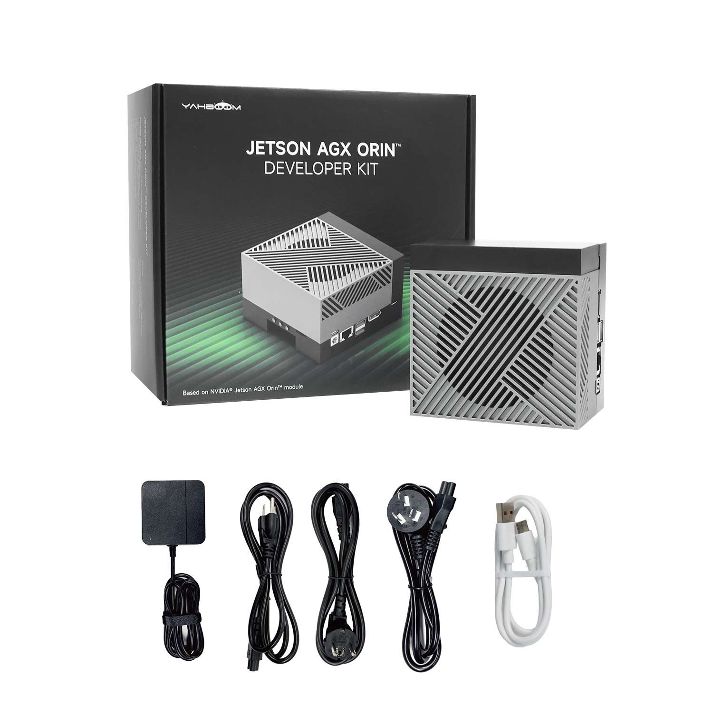

# Yahboom AGX Orin Developer Kit Based on NVIDIA Jetson AGX Orin core module with 32GB SUPER/64GB RAM(275 TOPS/241 TOPS)

# Introduction
The Yahboom AGX Orin development kit is based on the NVIDIA Jetson AGX Orin core module and Yahboom independently developed carrier board. Compared with NVIDIA's official Jetson AGX Orin developer kit, the two have only slight differences in appearance, but are completely identical in terms of functionality, interface configuration, installation holes, and computing performance. This developer kit adopts NVIDIA Ampere GPU architecture and has powerful edge AI computing performance of up to 275 TOPS/241 TOPS, making it an ideal platform for handling high load AI tasks, deep learning, computer vision, and advanced robot development.

# Features
* 【Powerful computing power (up to 275 TOPS) to handle complex AI workloads】

Jetson AGX Orin is based on NVIDIA Ampere GPU architecture and can support high demand applications such as deep learning, computer vision, robotics, and generative AI. It enables developers to directly run complex AI inference tasks on edge devices.

* 【Two memory configurations are available -32GB SUPER/64GB Users can choose between 32GB SUPER or 64GB LPDDR5 memory according to project requirements.】

After our upgrade, the 32GB version has a computing power of 241TOPS, achieving an excellent balance between performance, memory capacity, and price, making it a recommended choice for most AI development projects. The 64GB version has more abundant memory space, which can carry larger scale model weights, more complex computing tasks, and multi task parallelism. When the budget is sufficient, it is the most worry free long-term solution.

* 【Supports JETPACK 7.2.1, CUDA, TENSORT, and ISAAC ROS】

The 256GB solid-state drive we provide (optional) comes pre installed with NVIDIA JetPack 7.2.1 based on Ubuntu 24.04 LTS and integrates a powerful AI software ecosystem, including CUDA 13.2.1, TensorRT 10.16.2, NVIDIA DeepStream, NVIDIA Isaac ROS , and Jetson Agentic AI. With GPU accelerated AI computing, deep learning inference, real-time video analysis, and advanced robot development capabilities, help you start your development work more quickly

* 【Extensive application of artificial intelligence and large language models】

Jetson AGX Orin is designed specifically for advanced edge AI development, making it ideal for autonomous robotics, computer vision, intelligent video analysis, Large Language Modeling (LLM), Visual Language Modeling (VLM), and industrial automation. Whether you are building intelligent robots, developing real-time object detection systems, or deploying generative artificial intelligence applications, it provides a powerful computing foundation to help you turn your ideas into reality.

* 【Comprehensive tutorials and technical support】

Yahboom has prepared detailed development tutorials, technical documentation, and practical project resources for you to easily get started with Jetson AGX Orin. From system setup, software configuration, to AI LLM deployment and robot development, our resources will help you simplify the development process. In addition, we also provide professional technical support to your entire development process.

# More Details
[Click here](https://www.yahboom.store/products/jetson-agx-orin)

# Please Contact Us
If you have any problem when using our robot after checking the tutorial, please contact us.

### WhatsApp:
+86 18682378128

### Technical support email: 
support@yahboom.com
